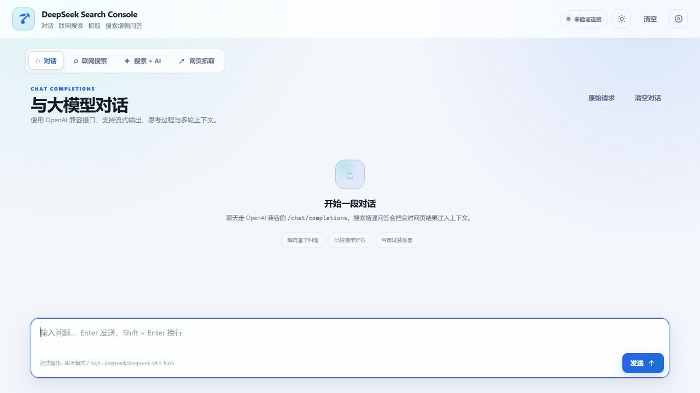

# DeepSeek Search Console

[](https://github.com/fzh000543/deepseek-search-console/releases)
[](LICENSE)

一个本地优先的 DeepSeek 工作台，把对话、实时网页搜索、网页抓取、搜索增强问答和来源空间树图放在同一个界面里。

所有 API Key 只保存在当前浏览器的 `localStorage` 中。项目的 Node.js 服务仅监听本机地址，用于转发请求和规避浏览器 CORS，不会把 Key 写入服务端文件或日志。



## 功能

- **对话**：兼容 OpenAI `POST /chat/completions`，支持 SSE 流式输出、思考过程和常用生成参数。
- **联网搜索**：调用 DeepSeek Search API，展示标题、摘要、正文、日期、权威度和相关度。
- **搜索增强问答**：先搜索，再让模型基于来源回答，并保留可点击引用。
- **来源空间树图**：按“检索主题 → 站点 → 页面”聚合搜索结果，支持展开、收起和详细卡片切换。
- **网页抓取**：调用 Fetch API，将网页转换为 Markdown。
- **连接与模型选择**：测试 `/models` 连接成功后，从实际返回的模型列表中选择后续使用的模型。
- **本地优先**：无需云数据库、账号系统或遥测服务。

## 下载即用

Windows 10/11 x64 用户可从 [Releases](https://github.com/fzh000543/deepseek-search-console/releases) 下载：

```text
DeepSeek-Search-Console.exe
```

双击 EXE 后会启动本地服务并自动打开浏览器。默认访问：

```text
http://127.0.0.1:3000
```

如果 3000 端口已被占用，EXE 会自动尝试后续端口。请保持控制台窗口开启；关闭窗口即停止服务。

也可以下载同版本 `.sha256` 文件校验 EXE 完整性。

## 从源码运行

环境要求：Node.js 18 或更高版本。

```bash
git clone https://github.com/fzh000543/deepseek-search-console.git
cd deepseek-search-console
npm ci
npm start
```

开发模式：

```bash
npm run dev
```

测试：

```bash
npm test
```

## 首次配置

1. 点击页面右上角的齿轮按钮打开设置。
2. 填写聊天 Base URL 和 API Key。
3. 点击“测试连接”。
4. 连接成功后，从下拉框选择 `/models` 实际返回的模型。
5. 如需独立搜索和抓取，再配置 Search / Fetch 地址和 Key，或勾选复用聊天 Key。

DeepSeek 官方地址示例：

```text
Chat Base URL: https://api.deepseek.com/v1
Search Base URL: https://api.deepseek.com/v1
```

只要你使用的网关兼容对应接口，也可以填写第三方或自建 Base URL。

## 接口路径

应用会根据 Base URL 自动拼出：

```text
GET  /models
POST /chat/completions
POST /tools/search
POST /tools/fetch
```

如果网关不提供 `/tools/search` 或 `/tools/fetch`，独立搜索和抓取会分别显示上游错误。

## 参数说明

### 生成参数

- `model`
- `system`
- `temperature`
- `top_p`
- `max_tokens`
- `n`
- `presence_penalty`
- `frequency_penalty`
- `seed`
- `stop`
- `stream`
- `thinking.type`
- `reasoning_effort`
- `response_format`

“高级覆盖 JSON”会浅合并到最终请求体，可追加 `tools`、`tool_choice`、`logit_bias`、`logprobs` 等字段。

### 搜索参数

- `query`：支持 `site:`、`-site:`、`OR`、引号短语、`after:`、`before:` 等操作符。
- `count`：1–50。
- `ori_question`：用于改善检索理解的原始问题。
- `localization`：本地化结果使用的 IP 地址。
- `need_content`：是否返回网页正文。

### 抓取参数

- `url`：HTTP/HTTPS URL，不能包含用户名或密码。

## 构建 Windows EXE

构建 EXE 需要 Node.js 22 或更高版本；运行时不需要安装 Node.js。构建产物不会提交到 Git，由 Release 或本地构建生成。

```bash
npm ci
npm run release
```

输出：

```text
release/DeepSeek-Search-Console.exe
release/DeepSeek-Search-Console.exe.sha256
```

发布新版本时推送版本标签即可触发 GitHub Actions：

```bash
git tag v1.0.0
git push origin v1.0.0
```

工作流会运行测试、构建 EXE、生成 SHA256，并创建 GitHub Release。

## 安全与隐私

- 服务默认只监听 `127.0.0.1`，不向局域网或公网开放。
- API Key 由浏览器保存并随请求发送给本地代理；本地代理只转发给设置中指定的上游地址。
- 服务端不记录 API Key，也不把 Key 写入原始请求面板。
- 仓库不包含 `.env`、真实 API Key、个人路径或本地浏览器数据。
- **不要把 `HOST` 改为 `0.0.0.0` 后直接暴露到公网。** 当前代理允许用户填写任意上游地址，公网部署前必须增加认证、访问控制和 SSRF 防护。
- 在共享电脑上使用后，请清除浏览器站点数据或恢复默认配置。

安全问题请按 [SECURITY.md](SECURITY.md) 中的方式报告，不要在公开 Issue 中粘贴密钥。

## 项目结构

```text
server.mjs                本地静态服务 + API 代理
public/index.html         页面结构
public/styles/            界面样式
public/js/api.js          API 与 SSE 解析
public/js/chat.js         对话模式
public/js/search.js       搜索、搜索增强、抓取和空间树图
public/js/settings.js     设置抽屉、连接测试和模型选择
public/js/payloads.js     请求体构建
test/proxy.test.mjs       代理层自动化测试
.github/workflows/        GitHub Release 构建流程
```

## 许可证

[MIT](LICENSE)